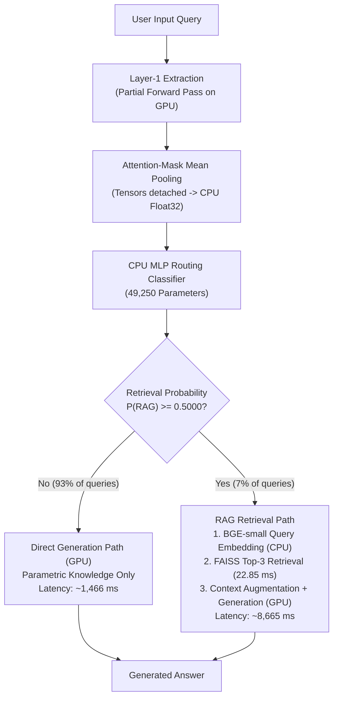
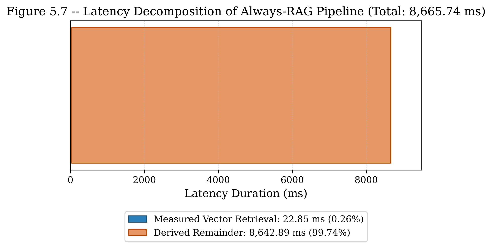
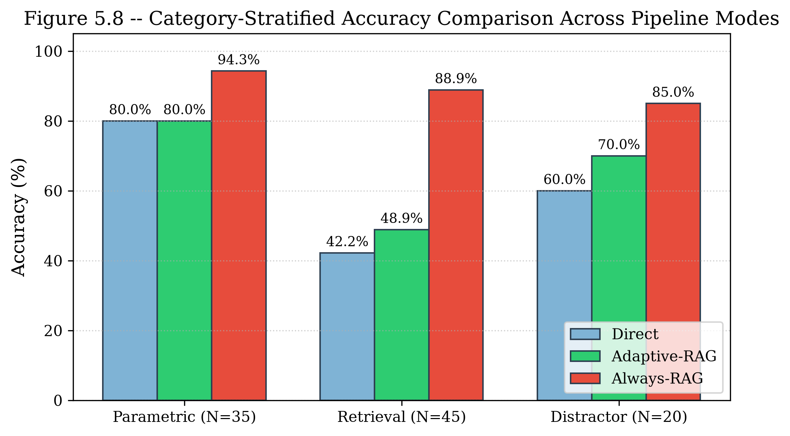
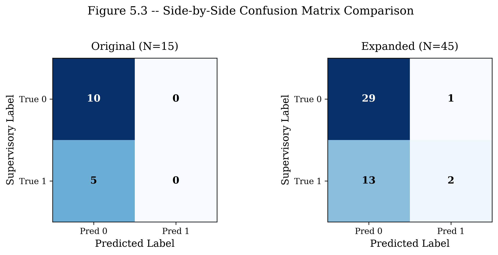
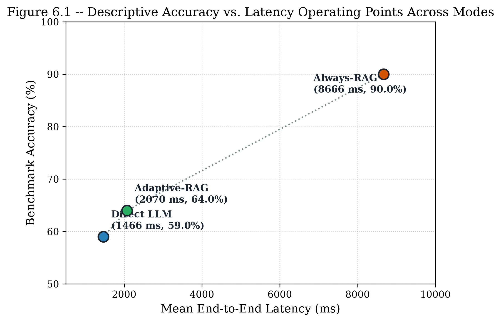

# Adaptive-RAG: Embedding-Informed Adaptive Retrieval-Augmented Generation (EI-ARAG)

[](https://www.python.org/)
[](https://pytorch.org/)
[](https://huggingface.co/)
[](https://github.com/facebookresearch/faiss)
[-green.svg)](https://www.nvidia.com/)
[](https://chennai.vit.ac.in/)

An empirical characterization and practical implementation of **Embedding-Informed Adaptive Retrieval-Augmented Generation (EI-ARAG)** running deterministically on resource-constrained consumer hardware (NVIDIA GTX 1650 4GB).

The framework inspects early internal transformer hidden states (**Layer 1**) to dynamically route queries: executing direct parametric generation for familiar queries while selectively triggering dense retrieval only when external knowledge is required.

---

## 1. Problem Statement & Motivation

Standard Retrieval-Augmented Generation follows an **"Always-RAG"** strategy: every prompt unconditionally initiates dense vector retrieval, document re-ranking, and prompt expansion. While effective for knowledge-intensive tasks, this induces two critical systemic penalties:

1. **Extreme Latency Overhead:** Appending retrieved context chunks expands input token length from $\sim 30$ tokens to $\sim 450$ tokens. Because autoregressive token generation cost scales with context size, end-to-end latency surges by nearly **$5.9\times$** ($8,665.74\text{ ms}$ vs. $1,466.09\text{ ms}$).
2. **Context Distraction & Poisoning:** Irrelevant or noisy retrieved passages can confound the LLM on queries it already possesses parametric knowledge to answer correctly.

**EI-ARAG** resolves this tension by deploying an ultra-lightweight CPU binary routing classifier (49,250 parameters) that intercepts early internal representations ($h_{\text{query}} \in \mathbb{R}^{1536}$) extracted after Layer 1. Queries with retrieval confidence $P(\text{RAG}) < 0.50$ bypass retrieval entirely, preserving parametric generation speed.

---

## 2. System Architecture



### Architectural Specifications

- **Generative Large Language Model:** `Qwen/Qwen2.5-1.5B-Instruct` (~1.54B parameters) running in half-precision (`torch.float16`) with greedy decoding (`temperature = 0.0`, `max_new_tokens = 128`).
- **GPU VRAM Optimization:** LLM weights and forward passes occupy **~2.9 GB VRAM**, safely below the 4,096 MB physical ceiling of the host NVIDIA GTX 1650.
- **Routing Signal Extraction:** Layer 1 contextualized activations (`outputs.hidden_states[1]`), mean-pooled across sequence tokens using the attention mask:
  $$\mathbf{h}_{\text{query}} = \frac{\sum_{i=1}^{L} m_i \cdot \mathbf{h}_{1, i}}{\sum_{i=1}^{L} m_i} \in \mathbb{R}^{1536}$$
- **Routing Classifier:** Compact Multi-Layer Perceptron (Input $\mathbb{R}^{1536} \rightarrow \text{Linear}(1536, 32) \rightarrow \text{ReLU} \rightarrow \text{Linear}(32, 2)$). Exactly **49,250 float32 parameters** running on CPU in **$<1.0\text{ ms}$**.
- **Dense Passage Retrieval:** `BAAI/bge-small-en-v1.5` ($d=384$) embeddings with FAISS `IndexFlatIP` (cosine similarity on normalized vectors), retrieving top $k=3$ passages.

---

## 3. Key Empirical Results & Trade-Off Analysis

All experimental numbers are frozen and validated against `data/expanded_evaluation_summary.json` across the primary 100-query stratified benchmark.

### 3.1 Primary Benchmark Comparison (100 Queries)

To accurately evaluate performance, Adaptive-RAG must be evaluated against both operational baselines independently:

| Metric / Dimension | Direct LLM (Parametric) | Adaptive-RAG (EI-ARAG) | Always-RAG (Baseline) | Comparison: Adaptive vs. Direct LLM | Comparison: Adaptive vs. Always-RAG |
| :--- | :---: | :---: | :---: | :---: | :---: |
| **Accuracy (%)** | **59.00%** | **64.00%** | **90.00%** | **+5.00 pp** (Accuracy Gain) | **-26.00 pp** (Accuracy Trade-Off) |
| **Correct Answers** | 59 / 100 | 64 / 100 | 90 / 100 | +5 correct answers | -26 correct answers |
| **Incorrect Answers** | 41 / 100 | 36 / 100 | 10 / 100 | -5 errors | +26 errors |
| **Average Latency (ms)** | **1,466.09 ms** | **2,070.16 ms** | **8,665.74 ms** | +604.07 ms (+41.2% routing overhead) | **-6,595.58 ms (76.11% latency reduction)** |
| **Median Latency (ms)** | 1,082.07 ms | 1,320.42 ms | 8,414.09 ms | +238.35 ms | -7,093.67 ms |
| **Minimum Latency (ms)** | 653.49 ms | 653.49 ms | 6,540.21 ms | 0.00 ms | -5,886.72 ms |
| **Maximum Latency (ms)** | 4,218.30 ms | 15,469.29 ms | 18,920.10 ms | +11,250.99 ms | -3,450.81 ms |
| **Retrieval Calls** | 0 / 100 (0.0%) | 7 / 100 (7.0%) | 100 / 100 (100.0%) | +7 retrieval calls | **-93 retrieval calls (93.0% calls saved)** |
| **Direct Path Invocations**| 100 / 100 (100.0%)| 93 / 100 (93.0%) | 0 / 100 (0.0%) | -7 direct queries | +93 direct queries |

---

### 3.2 Distinct Comparative Trade-Offs

#### Comparison 1: Adaptive-RAG vs. Direct LLM
- **Accuracy Improvement:** $+5.00$ percentage points ($64.00\%$ vs. $59.00\%$), converting 5 previously failed queries into correct answers.
- **Latency Overhead:** $+604.07\text{ ms}$ average latency increase ($2,070.16\text{ ms}$ vs. $1,466.09\text{ ms}$), reflecting the cost of Layer-1 extraction across all queries and 7 context-expanded RAG generations.

#### Comparison 2: Adaptive-RAG vs. Always-RAG
- **Latency Savings:** Saves **$6,595.58\text{ ms}$** per query on average.
  $$\text{Relative Latency Reduction} = \frac{8,665.74 - 2,070.16}{8,665.74} \times 100\% = \mathbf{76.11\%}$$
- **Retrieval Efficiency:** Bypasses dense vector retrieval and prompt expansion for **$93\text{ out of }100\text{ queries}$** ($93.0\%$ retrieval reduction).
- **Accuracy Trade-Off:** Achieves $64.00\%$ accuracy compared to Always-RAG's $90.00\%$ ($-26.00\text{ pp}$), stemming from conservative retrieval routing (13.33% recall on the held-out test split).

---

### 3.3 The Seven RAG-Routed Queries Breakdown

Across the 100-query benchmark, the routing classifier triggered retrieval ($P(\text{RAG}) \ge 0.5000$) for exactly **7 queries**.

Rather than applying conventional binary classification precision to an end-to-end system, the actual system outcomes are accurately characterized as:
- **5 Improvements:** Direct LLM failed, but retrieval corrected the answer.
- **2 Neutral Outcomes:** Direct LLM was already correct, and retrieval maintained the correct answer without harm.
- **0 Regressions:** Retrieval never corrupted or degraded a previously correct answer.

| Query ID | Question Prompt | Category | $P(\text{RAG})$ | Direct LLM Output | RAG-Augmented Output | System Outcome |
| :---: | :--- | :---: | :---: | :--- | :--- | :---: |
| **Q006** | In which year was the NVIDIA GeForce GTX 1650 launched? | Retrieval | **0.5833** | ❌ Guess: "2018" | ✅ Grounded: "2019" | **IMPROVEMENT (+1)** |
| **Q009** | How many CUDA cores are contained in the GeForce GTX 1650? | Distractor | **0.5671** | ❌ Guess: "2304" | ✅ Grounded: "896" | **IMPROVEMENT (+1)** |
| **Q031** | What was the exact date of Alan Turing's birth? | Retrieval | **0.5492** | ✅ "June 23, 1912" | ✅ "June 23, 1912" | **NEUTRAL (0)** |
| **Q035** | In which year was Alan Turing elected a Fellow of the Royal Society? | Retrieval | **0.5691** | ❌ Guess: "1950" | ✅ Grounded: "1951" | **IMPROVEMENT (+1)** |
| **Q045** | How many minutes after Neil Armstrong did Buzz Aldrin step onto lunar surface? | Retrieval | **0.5708** | ❌ Guess: "14 min" | ✅ Grounded: "19 min" | **IMPROVEMENT (+1)** |
| **Q086** | What is the approximate total length of the Nile River in kilometers? | Retrieval | **0.5608** | ✅ "6,650 km" | ✅ "6,650 km" | **NEUTRAL (0)** |
| **Q097** | Which form of ER is studded with ribosomes for protein synthesis? | Distractor | **0.5457** | ❌ Guess: "Smooth ER" | ✅ Grounded: "Rough ER"| **IMPROVEMENT (+1)** |

*(Note: Conventional ML test-set Label-1 precision measured on the unseen test split of the expanded dataset ($N=45$) was **66.67%** ($2/3$), with a recall of **13.33%** ($2/15$)).*

---

### 3.4 The Latency Bottleneck Discovery

Detailed timing instrumentation isolates the latency share across system stages:
- **Mean Vector Retrieval Latency (BGE + FAISS):** Exactly **22.85 ms** per query.
- **Retrieval Share of Total Latency:**
  $$\frac{22.85\text{ ms}}{8,665.74\text{ ms}} \times 100\% = \mathbf{0.26\%}$$
- **Generation & Context Processing:** **$\sim 6,000\text{--}8,000\text{ ms}$ ($>95\%$ of total execution duration)**.

> **Crucial Finding:** Dense vector retrieval ($22.85\text{ ms}$) is virtually instantaneous and does **NOT** represent the latency bottleneck of RAG. The bottleneck is the autoregressive processing of long prompt contexts in the LLM. By routing 93% of queries directly, EI-ARAG sidesteps context expansion for the vast majority of requests.

---

## 4. Key Performance Visualizations

| Latency Decomposition | Category-Wise Accuracy |
| :---: | :---: |
|  |  |

| Confusion Matrix (Side-by-Side) | Accuracy vs. Latency Trade-Off |
| :---: | :---: |
|  |  |

---

## 5. Repository Structure

```
adaptive-rag-ei-arag/
├── README.md                           # Master architectural and empirical documentation
├── requirements.txt                    # Pinned virtual environment dependencies
├── .gitignore                          # Exclusion rules for caches and binaries
│
├── src/                                # Core framework source code
│   ├── core/
│   │   ├── llm_loader.py               # Singleton manager for Qwen2.5-1.5B (float16, GPU)
│   │   └── layer_extractor.py          # Partial forward pass Layer-1 hidden state extractor
│   ├── classifier/
│   │   ├── model.py                    # SmallRetrievalClassifier (49,250-param MLP)
│   │   ├── train.py                    # Class-weighted AdamW training harness
│   │   └── data_generator.py           # Dual-inference automated dataset labeler
│   ├── retrieval/
│   │   ├── retriever.py                # Dense vector retriever (BGE-small + FAISS)
│   │   └── indexer.py                  # Text chunking and FAISS index builder
│   └── pipelines/
│       ├── adaptive_rag.py             # Tri-mode AdaptiveRAGPipeline implementation
│       └── baseline_rag.py             # Unconditional Always-RAG baseline pipeline
│
├── config/
│   └── config.py                       # Centralized configuration dataclasses & relative paths
│
├── scripts/                            # Operational runners, demos & benchmark evaluators
│   ├── run_chat.py                     # Interactive desktop GUI chatbot with routing telemetry
│   ├── run_explainability.py           # Interactive GUI explainability & routing inspector
│   ├── run_routing_dashboard.py        # Desktop GUI evaluation dashboard & metric viewer
│   ├── run_full_evaluation.py          # 100-query benchmark evaluation runner
│   ├── run_validation_smoke_test.py    # 15-query validation smoke test
│   ├── run_adaptive_demo.py            # CLI tri-mode comparison demo
│   ├── train_expanded_classifier.py    # Retrains expanded MLP classifier on 310 samples
│   └── extract_expanded_embeddings.py  # Layer-1 representation extraction script
│
├── data/                               # Evaluation datasets, metadata & corpus
│   ├── raw_corpus/                     # 12 domain knowledge text files
│   ├── benchmark_queries.json          # 100 stratified evaluation benchmark queries
│   ├── evaluation_summary.json         # Frozen evaluation results (original classifier)
│   ├── expanded_evaluation_summary.json# Frozen evaluation results (expanded classifier)
│   ├── evaluation_results_100.json     # Detailed individual query outputs and timings
│   ├── chunks_metadata.json            # Passage metadata mapped to vector index
│   └── faiss_index.bin                 # Pre-built FAISS dense vector index
│
├── models/                             # Trained classifier checkpoints & metadata
│   ├── classifier_expanded.pt          # Primary expanded routing model (199 KB)
│   ├── classifier_expanded_metadata.json # Training hyperparameters and validation splits
│   └── classifier_small.pt             # Baseline classifier model
│
├── outputs/figures/                    # High-resolution publication figures & charts
│
└── docs/                               # In-depth architectural & reproduction documentation
    ├── architecture.md                 # Hardware profiling and component specifications
    ├── evaluation_results.md           # Granular frozen benchmark numbers and logs
    └── reproduction_guide.md           # Step-by-step reproduction instructions
```

---

## 6. Quick Start & Reproduction

### 6.1 Installation

```bash
git clone https://github.com/vasanth-09ux/adaptive-rag-ei-arag.git
cd adaptive-rag-ei-arag

python -m venv .venv
# On Windows:
.venv\Scripts\activate
# On Linux/macOS:
source .venv/bin/activate

pip install -r requirements.txt
```

### 6.2 Interactive Desktop Applications

Launch the interactive Tkinter desktop GUI tools:

```bash
# 1. Normal Chat Application with live routing telemetry
python scripts/run_chat.py

# 2. Explainability & Routing Inspector (displays confidence meters and passage previews)
python scripts/run_explainability.py

# 3. Routing & Evaluation Dashboard (renders frozen benchmark figures without needing GPU)
python scripts/run_routing_dashboard.py
```

### 6.3 Running Validation Tests & Benchmark

```bash
# Run 15-query validation smoke test
python scripts/run_validation_smoke_test.py

# Run full 100-query comparative evaluation
python scripts/run_full_evaluation.py
```

---

## 7. Limitations & Ethical Bounds

- **Academic Contribution Scope:** This project represents an **empirical characterization study** in applied ML/NLP under consumer hardware constraints. It is not an algorithmic novelty paper; the concept of hidden-state routing was proposed by Huang et al. (COLING 2025).
- **Label Imbalance & Classifier Recall:** At small dataset scales (310 samples), severe class imbalance results in conservative retrieval routing (13.33% test recall). While routed queries exhibited zero regressions (5 improvements and 2 neutral outcomes), expanding the training corpus is necessary to improve recall.
- **Corpus Scale:** The reference corpus is designed for evaluation across 12 domain verticals. Scaling to millions of documents would necessitate distributed vector indexing (e.g., HNSW or IVFPQ).

---

## 8. References & Academic Attributions

- **Huang et al.** (2025). *Embedding-Informed Adaptive Retrieval-Augmented Generation of Large Language Models.* Proceedings of COLING 2025. *(Primary conceptual inspiration for Layer-1 routing)*.
- **Lewis et al.** (2020). *Retrieval-Augmented Generation for Knowledge-Intensive NLP Tasks.* NeurIPS 2020.
- **Karpukhin et al.** (2020). *Dense Passage Retrieval for Open-Domain Question Answering.* EMNLP 2020.
- **Mallen et al.** (2023) & **Jeong et al.** (2024). *Dual-Inference Automated Label Generation Protocol.*
- **Qwen Team** (2024). *Qwen2.5 Technical Report.* Alibaba Cloud.
- **Johnson, Douze, & Jégou** (2021). *Billion-scale similarity search with GPUs (FAISS).* IEEE Transactions on Big Data.

---

## 9. Author

**Vasanth**  
*Integrated M.Tech in Software Engineering, Vellore Institute of Technology (VIT), Chennai*  
*AWS Certified Solutions Architect – Associate*  
GitHub: [@vasanth-09ux](https://github.com/vasanth-09ux)
