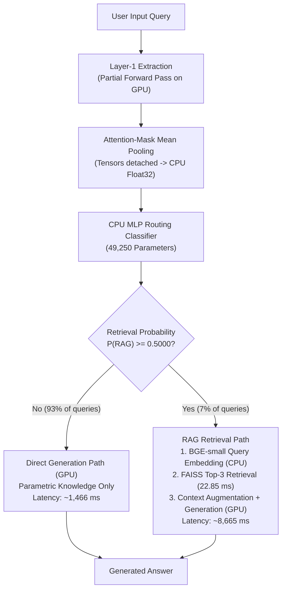

# System Architecture: Embedding-Informed Adaptive-RAG (EI-ARAG)

## 1. Architectural Philosophy & Tri-Mode Paradigm

Traditional Retrieval-Augmented Generation (RAG) pipelines follow an **"Always-RAG"** policy: every input query indiscriminately triggers dense vector retrieval, context expansion, and prompt augmentation. While this ensures external knowledge availability, it introduces substantial drawbacks:
1. **Severe Latency Overhead:** Autoregressive processing over long context windows multiplies execution time by $\sim 5.9\times$ compared to direct parametric generation ($8,665.74\text{ ms}$ vs. $1,466.09\text{ ms}$).
2. **Context Poisoning / Distraction:** Incompetent or irrelevant retrieved passages can mislead the LLM into generating hallucinations or degraded answers for queries it already knows internally.
3. **Resource Waste:** In high-throughput settings, vector search and context-heavy token generation exhaust compute budgets unnecessarily.

**EI-ARAG (Embedding-Informed Adaptive Retrieval-Augmented Generation)** implements an intelligent routing mechanism that inspects internal model representations after the very first transformer layer to dynamically decide whether retrieval is necessary before committing to full autoregressive generation.

---

## 2. Resource-Constrained Hardware Engineering

A core contribution of this project is proving that adaptive routing can be executed deterministically on consumer workstation hardware without requiring enterprise cluster infrastructure.

| Dimension | Host Specification | System Allocation |
| :--- | :--- | :--- |
| **GPU** | NVIDIA GeForce GTX 1650 (Turing TU117) | Dedicated to Generative LLM weights & Layer-1 forward pass (`cuda:0`) |
| **VRAM Ceiling** | 4,096 MB (4 GB) GDDR5/GDDR6 | LLM operates in `torch.float16` consuming **~2.9 GB**, staying safely below OOM |
| **Host CPU** | Multi-core x86_64 host CPU | Runs BGE embeddings, FAISS indexing, and MLP classifier inference |
| **System RAM** | 16 GB DDR4 | Hosts FAISS indices, corpus chunks, and Python runtime |

---

## 3. Core System Components

### 3.1 Generative Large Language Model
- **Identifier:** `Qwen/Qwen2.5-1.5B-Instruct`
- **Parameter Scale:** ~1.54 Billion parameters
- **Precision:** Half-Precision Floating Point (`torch.float16`)
- **Decoding Configuration:** Deterministic greedy decoding (`temperature = 0.0`, `do_sample = False`, `max_new_tokens = 128`, `pad_token_id = eos_token_id`).

### 3.2 Layer-1 Hidden State Representation Extraction
Inspired by Huang et al. (COLING 2025), the routing signal is extracted from the early representational dynamics of the LLM:
- **Layer Index:** Transformer Layer 1 (`model.layers[1]`, accessed as `outputs.hidden_states[1]`).
- **Rationale:** Layer 1 provides the earliest contextualized representation beyond raw static token embeddings (`hidden_states[0]`). It encodes query syntactic familiarity and parametric confidence while requiring only a fraction of the GPU forward-pass compute.
- **Hidden Dimension:** $d = 1536$.
- **Pooling Operator:** Attention-mask-aware mean pooling across valid sequence tokens:
  $$\mathbf{h}_{\text{query}} = \frac{\sum_{i=1}^{L} m_i \cdot \mathbf{h}_{1, i}}{\sum_{i=1}^{L} m_i}$$
  where $m_i \in \{0, 1\}$ is the attention mask, and $\mathbf{h}_{1, i} \in \mathbb{R}^{1536}$ is the Layer-1 activation vector at token position $i$.
- **Tensor Offloading:** Tensors are detached from the computational graph, converted to `torch.float32`, and offloaded to CPU host memory.

### 3.3 Ultra-Lightweight CPU Routing Classifier
- **Model Class:** `SmallRetrievalClassifier` (Multi-Layer Perceptron)
- **Architecture:** $\mathbb{R}^{1536} \rightarrow \text{Linear}(1536, 32) \rightarrow \text{ReLU} \rightarrow \text{Linear}(32, 2)$
- **Parameter Count:**
  - Layer 1: $1536 \times 32 + 32 = 49,184$ parameters
  - Layer 2: $32 \times 2 + 2 = 66$ parameters
  - **Total:** Exactly **49,250** trainable parameters
- **Runtime Cost:** Executes on host CPU in **$< 1.0\text{ ms}$**, eliminating the need for expensive secondary LLM routing prompts.
- **Decision Rule:** Softmax output yields probability distribution $[P(\text{Direct}), P(\text{RAG})]$. If $P(\text{RAG}) \ge 0.5000$, retrieval is triggered.

### 3.4 Dense Passage Retrieval Stack
- **Bi-Encoder Embedding Model:** `BAAI/bge-small-en-v1.5` ($d = 384$) executed on CPU.
- **Vector Index:** FAISS `IndexFlatIP` (Exact inner product on $L_2$-normalized dense embeddings, equivalent to cosine similarity).
- **Corpus Processing:** Text passages partitioned with chunk size $256$ tokens and overlap $32$ tokens across 12 domain verticals.
- **Top-K:** Retrieves top $k = 3$ most relevant passages.
- **Retrieval Latency:** Average vector search latency is **22.85 ms** per query.

---

## 4. Latency Profiling & Bottleneck Analysis

A critical empirical insight from this architecture is the decomposition of end-to-end execution latency:

| Operation | Device | Typical Latency | Share of Always-RAG Latency |
| :--- | :---: | :---: | :---: |
| **Layer-1 Extraction** | GPU | ~12.0 ms | 0.14% |
| **MLP Classifier Forward Pass**| CPU | ~0.5 ms | 0.01% |
| **Vector Retrieval (BGE + FAISS)**| CPU | **22.85 ms** | **0.26%** |
| **Direct Autoregressive Generation**| GPU | ~1,450 ms | 16.73% |
| **Augmented Context Autoregressive Generation**| GPU | **~8,640 ms** | **99.70%** |

> **Key Architectural Insight:** Vector retrieval (22.85 ms) is **NOT** the latency bottleneck of RAG systems. The bottleneck is the autoregressive processing of long prompt contexts (retrieved passages expand context from $\sim 30$ tokens to $\sim 450$ tokens), which slows GPU decoding down by nearly $5.9\times$. By routing 93% of queries directly, EI-ARAG reduces overall latency by **76.11%** ($6,595.58\text{ ms}$ saved per query) compared to Always-RAG.
